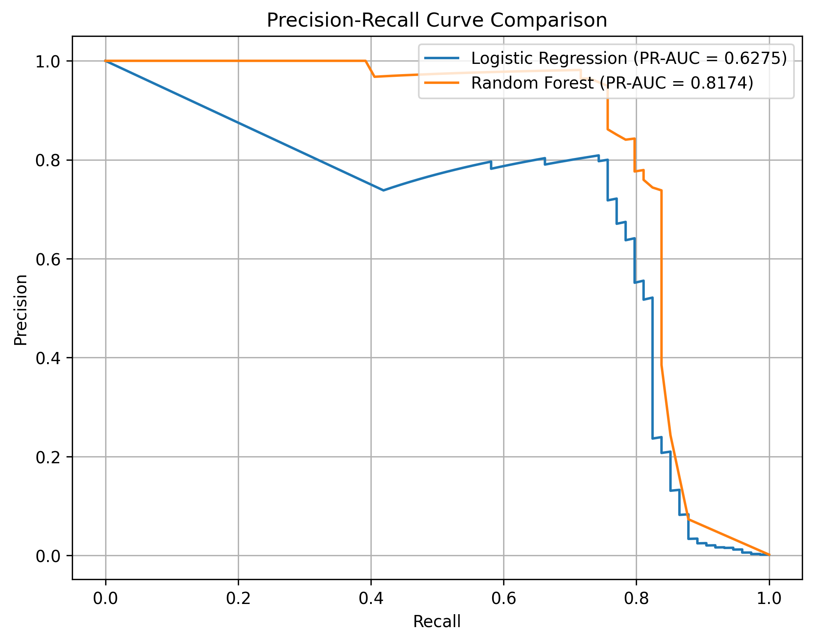

# 随机森林模型分析报告 (B3)

## 1. 实验设置

*   **不平衡处理**：采用 `class_weight='balanced_subsample'` 赋予少数类更高的权重。
*   **参数配置**：`n_estimators=100`，随机种子设定为 `42`。
*   **评估标准**：与逻辑回归（LR）保持一致，初始阈值设定为 `0.5`，并生成连续预测概率以供后续阈值调整。

## 2. 核心指标对比

验证集（包含 74 笔真实欺诈交易）上的模型表现如下：

| 评估指标 | 逻辑回归 (LR) | 随机森林 (RF) | 评价 |
| :--- | :--- | :--- | :--- |
| **PR-AUC** | 0.6275 | **0.8174** | RF 显著占优 |
| **Recall (召回率)** | **0.8784** | 0.6892 | LR 抓到了更多欺诈 |
| **Precision (精确率)** | 0.0670 | **0.9808** | RF 误判极少 |
| **F1-Score** | 0.1245 | **0.8095** | 综合 Precision 和 Recall，RF 占优 |
| **MCC** | 0.2393 | **0.8219** | 极端不平衡下的综合指标，RF 占优 |
| **False Positives (误报数)**| 905 | **1** | RF误报极少 |

## 3. 随机森林模型综合评价

结合数据与 PR 曲线对比图，对随机森林的表现作如下科学分析：

**模型对比：** PR 曲线下面积越大，模型综合分类效果越好。随机森林（橙色）的 PR 曲线全面包裹逻辑回归（蓝色），其 PR-AUC (0.8174) 显著高于 LR (0.6275)，证明树模型在捕捉非线性特征组合、区分高度重叠的正常/欺诈样本时更具优势。

**高置信度区间：** RF 在召回率 0 到 0.7 的区间内，精确率保持在 98% 以上，说明其给出的高分预测极度可靠，这对应了它在 0.5 阈值下极低的误报数（仅 1 个）。

**权衡与拐点：** 当召回率超过 0.75 后，两模型精确率均断崖下跌。这提示我们在后续的阈值选择中，不应盲目追求绝对的高召回。保留在曲线拐点处（Recall≈0.75, Precision>0.8）的模型参数，既能把漏报率控制在 25% 左右，又能维持极低的误判成本。

### 3.1 显著优势：极高的精确率与排序能力
*   **误报控制**：在 0.5 的默认阈值下，随机森林在成功抓出 51 个欺诈者的同时，仅产生了 **1 笔误报**（Precision 高达 98.08%）。这说明随机森林给出的高分预测极其可靠。
*   **特征捕捉**：PR-AUC 从 0.6275 跃升至 0.8174，证明树模型能够有效捕捉 V1-V28 之间复杂的非线性组合关系，其整体排序能力全面优于线性模型（LR）。

### 3.2 显著痛点：高阈值下的“保守”倾向
*   **召回率偏低**：在 0.5 阈值下，RF 的 Recall 仅为 0.6892，漏掉了 23 个欺诈交易（False Negatives）。这是因为在极端不平衡数据下，RF 倾向于在特征极其明显时才给出极高分（>0.5）。
*   **从 PR 曲线看**：RF 曲线在 Recall 0~0.7 的区间内，Precision 几乎维持在 1.0 的水平，这说明模型在很大的阈值范围内，它能在抓到大部分正样本，并保证预测结果高精确，对正样本的识别能力很强。但一旦越过 0.75，精确率会迅速下跌。

## 4. 业务落地与后续优化建议

*   **业务视角的权衡**：信用卡风控中，误报（骚扰正常用户、浪费人工审核）的成本极高。逻辑回归的 905 笔误报在实际业务中不可接受，而随机森林仅 1 笔的误报极具业务落地价值。
*   **后续优化方向（B5 任务）**：当前 RF 的缺陷是漏报偏多。在后续的阈值分析中，我们需要沿着 PR 曲线，将 RF 的分类阈值从 0.5 **适度下调**（例如调整至 0.2~0.3）。这样可以在仅增加极小误报（如几十个）的代价下，大幅提升召回率，找到最适合业务人工审核容量的平衡点。
