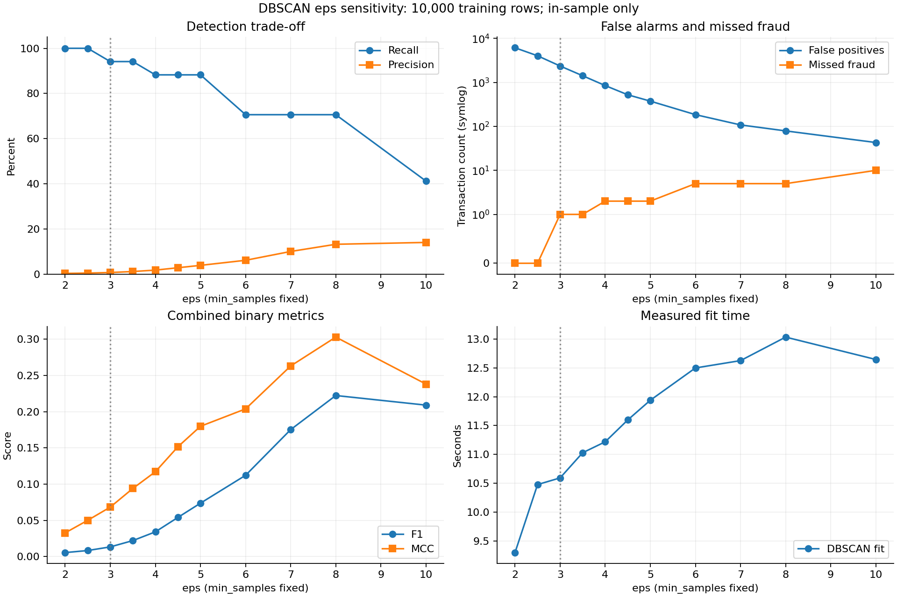
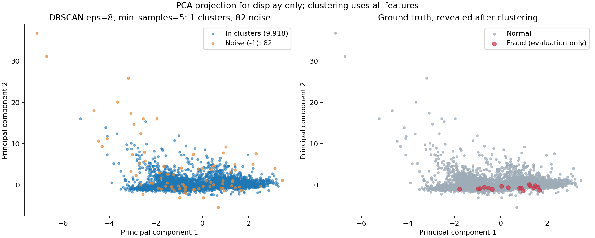

# DBSCAN 无监督异常检测实验汇报

## 一、实验目标与阶段结论

本实验使用密度聚类识别信用卡交易中的异常候选，并在聚类完成后用真实欺诈标签评价检测能力。当前已完成初始参数实验、eps 扩展实验，以及固定 eps=8 的 min_samples 扩展实验，共 **22 次实际运行、18 组不同参数组合**。重复参数用于核对复现结果，不能作为不同抽样上的独立重复实验。

在已测试组合中，**eps=8、min_samples=5** 的 F1 和 MCC 最高：从 10,000 条交易中标出 **82 条异常候选**，检出 **12/17 条欺诈**，误报 **70 条正常交易**，漏报 **5 条欺诈**；Recall=70.59%，Precision=14.63%，F1=0.2424，MCC=0.3193。

这一配置可作为下一阶段验证的候选方案。它仍有较多误报，且漏掉了 5 条欺诈；本报告展示的是同一训练样本上的探索结果，不能据此认定为未知交易上的最优参数或最终业务方案。

## 二、数据与统一实验设置

数据来自 A 提供的 `data/processed/X_train.csv`，完整训练特征共 199,364 行、30 个字段。按 seed=42 均匀无放回抽取 10,000 行，样本中真实欺诈 17 条、正常交易 9,983 条，欺诈占比为 0.17%。抽样不按 Class 分层，也不按标签增减欺诈数量。

三轮使用完全相同的样本，cohort_id=`4114612fcadac989`。抽样位置见 [unsupervised_sample_indices.csv](../results/tables/dbscan_result/unsupervised_sample_indices.csv)，`row_index` 是从 0 开始的训练 CSV 行位置，不是原始数据行号。

A 已对 Time、Amount 做标准化。为减少其他 V 特征方差差异对距离的影响，本实验另用完整训练特征拟合全特征 StandardScaler，并固定该缩放器进行三轮实验；不覆盖 A 的处理后 CSV。聚类使用全部 30 个特征、欧氏距离和相同的样本顺序。PCA 仅用于二维绘图，不参与实际聚类。

模型拟合和抽样不输入 Class。标签仅在模型拟合完成后用于评价。后续扩展是在已看过前轮结果后进行的，因此参数范围探索及候选配置比较属于事后分析，不能描述为完全未参考评价结果的独立参数验证。本阶段未读取验证集或测试集。

每次拟合最多允许 180 秒，使用单个计算任务。下表耗时来自各次真实运行，不同轮次同参数的耗时略有差异；更完整的进程启动耗时保存在原指标 CSV 的 wall_seconds 中。

## 三、参数和评价口径

`eps` 定义邻域的距离半径；`min_samples` 定义成为核心点所需的邻域样本数量，包含样本自身。非核心点若位于核心点邻域，也可以作为边界点加入簇。`cluster_label=-1` 的交易被记为噪声，定义为异常候选；噪声不等同于欺诈。

固定 min_samples 时，增大 eps 会放宽邻域条件，更多点可能加入簇，噪声候选减少；这可能同时减少误报并增加漏报。固定 eps 时，增大 min_samples 会提高密度要求，噪声候选可能增加，但新增候选未必是欺诈。

评价以真实欺诈为正类：TP 为检出的欺诈，FP 为正常交易被误报，FN 为漏掉的欺诈，TN 为正确判为非异常的正常交易。

- Recall = TP / (TP + FN)，衡量真实欺诈中抓到了多少。
- Precision = TP / (TP + FP)，衡量异常候选中有多少是真正欺诈。
- F1 = 2TP / (2TP + FP + FN)，综合查准率和查全率。
- MCC 同时考虑 TP、TN、FP、FN，范围为 -1 到 1，越接近 1 表示预测与标签的正相关程度越强。
- 误报数为 FP；本文“候选中的误报比例”是 FP / (TP + FP)，与“正常交易误报率”FP / (FP + TN) 的分母不同。


## 四、第一轮：固定 min_samples=10 扩展 eps

预先列出 eps=2、2.5、3、3.5、4、4.5、5、6、7、8、10 共 11 个值，其余条件保持一致。全部结果如下。

| eps | min_samples | 簇数 | 异常候选 | 检出欺诈 | 误报 | 漏报 | Recall | Precision | F1 | MCC | 拟合秒数 |
| ---: | ---: | ---: | ---: | ---: | ---: | ---: | ---: | ---: | ---: | ---: | ---: |
| 2 | 10 | 51 | 6139 | 17/17 | 6122 | 0 | 100.00% | 0.28% | 0.0055 | 0.0327 | 9.30 |
| 2.5 | 10 | 19 | 4045 | 17/17 | 4028 | 0 | 100.00% | 0.42% | 0.0084 | 0.0501 | 10.48 |
| 3 | 10 | 10 | 2374 | 16/17 | 2358 | 1 | 94.12% | 0.67% | 0.0134 | 0.0683 | 10.59 |
| 3.5 | 10 | 4 | 1433 | 16/17 | 1417 | 1 | 94.12% | 1.12% | 0.0221 | 0.0940 | 11.03 |
| 4 | 10 | 1 | 862 | 15/17 | 847 | 2 | 88.24% | 1.74% | 0.0341 | 0.1171 | 11.22 |
| 4.5 | 10 | 1 | 538 | 15/17 | 523 | 2 | 88.24% | 2.79% | 0.0541 | 0.1515 | 11.60 |
| 5 | 10 | 1 | 390 | 15/17 | 375 | 2 | 88.24% | 3.85% | 0.0737 | 0.1798 | 11.94 |
| 6 | 10 | 1 | 197 | 12/17 | 185 | 5 | 70.59% | 6.09% | 0.1121 | 0.2038 | 12.50 |
| 7 | 10 | 1 | 120 | 12/17 | 108 | 5 | 70.59% | 10.00% | 0.1752 | 0.2630 | 12.63 |
| 8 | 10 | 1 | 91 | 12/17 | 79 | 5 | 70.59% | 13.19% | 0.2222 | 0.3028 | 13.04 |
| 10 | 10 | 1 | 50 | 7/17 | 43 | 10 | 41.18% | 14.00% | 0.2090 | 0.2380 | 12.65 |

eps 从 2 增到 10 时，异常候选从 6,139 条降至 50 条，误报从 6,122 条降至 43 条，但检出欺诈从 17 条降至 7 条。因此，候选越少并不意味着识别能力越好。

本轮 eps=8 的 F1=0.2222、MCC=0.3028 均为网格内最高；91 条候选中检出 12 条欺诈，误报 79 条，漏报 5 条。eps=10 的 Precision 略高至 14.00%，但只检出 7/17 条欺诈，F1 和 MCC 均低于 eps=8。

若更重视降低漏报，eps=5、min_samples=10 可以作为另一种权衡：检出 15/17 条欺诈、漏报 2 条，但需处理 390 条候选，其中 375 条正常交易被误报。

[本轮完整指标 CSV](../results/tables/dbscan_result/dbscan_eps_sweep_metrics.csv)；[运行参数与数据指纹](../results/dbscan_eps_sweep_run.json)。逐样本标签保存在 `dbscan_eps_sweep_labels.npz`，包含 eps、row_index 与 cluster_labels。



## 五、第二轮：固定 eps=8 扩展 min_samples

根据第一轮的观察固定 eps=8，预先设置 min_samples=5、10、20、30、50，共 5 次运行。

| eps | min_samples | 簇数 | 异常候选 | 检出欺诈 | 误报 | 漏报 | Recall | Precision | F1 | MCC | 拟合秒数 |
| ---: | ---: | ---: | ---: | ---: | ---: | ---: | ---: | ---: | ---: | ---: | ---: |
| 8 | 5 | 1 | 82 | 12/17 | 70 | 5 | 70.59% | 14.63% | 0.2424 | 0.3193 | 13.94 |
| 8 | 10 | 1 | 91 | 12/17 | 79 | 5 | 70.59% | 13.19% | 0.2222 | 0.3028 | 15.04 |
| 8 | 20 | 1 | 95 | 12/17 | 83 | 5 | 70.59% | 12.63% | 0.2143 | 0.2962 | 14.37 |
| 8 | 30 | 1 | 100 | 12/17 | 88 | 5 | 70.59% | 12.00% | 0.2051 | 0.2886 | 14.34 |
| 8 | 50 | 1 | 107 | 12/17 | 95 | 5 | 70.59% | 11.21% | 0.1935 | 0.2788 | 13.51 |

五组均检出 12/17 条欺诈，Recall 同为 70.59%，漏报同为 5 条。min_samples 增大时，候选从 82 条增至 107 条，新增的 25 条候选均为正常交易，因此误报增加、Precision、F1 和 MCC 下降。

本轮 min_samples=5 的 F1=0.2424、MCC=0.3193 均最高。相比 min_samples=10，它没有减少检出的欺诈，但少产生了 9 次误报。

[本轮完整指标 CSV](../results/tables/dbscan_result/dbscan_min_samples_sweep_metrics.csv)；[运行参数与数据指纹](../results/dbscan_min_samples_sweep_run.json)。逐样本标签保存在 `dbscan_min_samples_sweep_labels.npz`。单独的轮次记录见 [min_samples 实验记录](../results/dbscan_min_samples_experiment_notes.md)。


## 六、当前候选配置与误报分析

综合已测试组合中的 F1、MCC，当前重点候选为 **eps=8、min_samples=5**。其混淆矩阵如下：

| DBSCAN 判定 | 真实欺诈 | 真实正常 | 合计 |
| --- | ---: | ---: | ---: |
| 噪声候选 | 12 | 70 | 82 |
| 非噪声 | 5 | 9913 | 9918 |
| 合计 | 17 | 9983 | 10000 |

82 条候选中仍有 70 条正常交易，候选中的误报比例为 **85.37%**。若按全部正常交易计算，正常交易误报率为 70/9983，约 **0.70%**。两者分母不同，都应在解释检测负担时说明。

这一结果相较原始基线减少了大量误报，但漏报从 1 条增加到 5 条。是否接受该权衡，仍需结合后续复核能力与漏报成本讨论，不能只依据一个指标决定实际使用方案。



## 七、辅助异常分数与排序指标

DBSCAN 本身不直接提供标准连续欺诈概率。本实验的 anomaly_score 是距第 (min_samples-1) 个其他邻居的欧氏距离，作为局部稀疏程度的辅助排序分数，数值越大代表局部越稀疏。PR-AUC 采用 average precision（AP），不与梯形积分混用；簇编号不作概率。

固定 min_samples=10 改变 eps 时，该辅助分数不变，因此 AP=0.1419、ROC-AUC=0.9679、Recall@100=0.7059、Recall@500=0.8824、Recall@1000=0.8824 在第二轮各 eps 下相同。这些数值不是 eps 调整带来的改善。

第三轮改变 min_samples 时，辅助 kNN 的 k 也改变，排序指标如下：

| min_samples | 其他邻居 k | 辅助 AP | 辅助 ROC-AUC | Recall@100 | Recall@500 | Recall@1000 |
| ---: | ---: | ---: | ---: | ---: | ---: | ---: |
| 5 | 4 | 0.1153 | 0.9678 | 0.7059 | 0.8824 | 0.8824 |
| 10 | 9 | 0.1419 | 0.9679 | 0.7059 | 0.8824 | 0.8824 |
| 20 | 19 | 0.1422 | 0.9674 | 0.7059 | 0.8824 | 0.8824 |
| 30 | 29 | 0.1358 | 0.9666 | 0.5882 | 0.8824 | 0.9412 |
| 50 | 49 | 0.1279 | 0.9652 | 0.5882 | 0.8824 | 0.9412 |

因此，当前候选 eps=8、min_samples=5 的辅助 AP 为 0.1153，低于 min_samples=10 的 0.1419，而二元 F1 更高。这并不矛盾：前者比较不同 k 的距离排序，后者评价具体噪声判定规则，不能当作同一项能力。

Recall@K 表示分数最高的 K 条交易中覆盖了多少真实欺诈。同分时按 row_index 升序排列；若 K 大于样本数，使用全部样本并保存 effective_k。本阶段的 K 均小于 10,000。

## 八、复现方式

以下命令在项目根目录执行：

```bash
python src/dbscan_src/unsupervised.py
python src/dbscan_src/dbscan_eps_sweep.py
python src/dbscan_src/dbscan_min_samples_sweep.py
python src/dbscan_src/export_dbscan_results.py --eps 8 5
```

完整的基础入口还会运行项目中已有的其他方法。原始数据位置与依赖安装步骤见 [项目 README](../README.md)。当前报告整理直接使用已保存的真实实验指标，没有为修改汇报而重新训练。

## 九、局限与下一阶段计划

当前所有指标均来自用于聚类的训练抽样，不能直接解释为对未知交易的泛化能力。同一样本上连续查看并比较参数会产生选择偏差；样本中只有 17 条欺诈，单条交易就会使 Recall 变化约 5.88 个百分点。

下一阶段应固定候选参数，在不同训练抽样上检查簇结构和误报稳定性，并与团队约定独立验证方案。若使用验证标签选择参数，需要明确说明该选择步骤参考了标签，同时保留测试集作最终评价。与监督模型比较时须统一交易样本、划分、指标定义和阈值依据。

在这些工作完成之前，报告结论为：**DBSCAN 已完成可复现的初步实验，并观察到参数对误报和漏报的明显影响；eps=8、min_samples=5 是目前已测试组合中的后续验证候选，尚不是已验证的最终方案。**

## 十、技术依据与原始记录

- [scikit-learn DBSCAN 参数说明](https://scikit-learn.org/stable/modules/generated/sklearn.cluster.DBSCAN.html)
- [Average precision 定义](https://scikit-learn.org/stable/modules/generated/sklearn.metrics.average_precision_score.html)
- [初始运行元数据](../results/unsupervised_run.json)
- [初始六组指标](../results/tables/dbscan_result/dbscan_parameter_experiments.csv)
- [eps 扩展指标](../results/tables/dbscan_result/dbscan_eps_sweep_metrics.csv)
- [min_samples 扩展指标](../results/tables/dbscan_result/dbscan_min_samples_sweep_metrics.csv)
