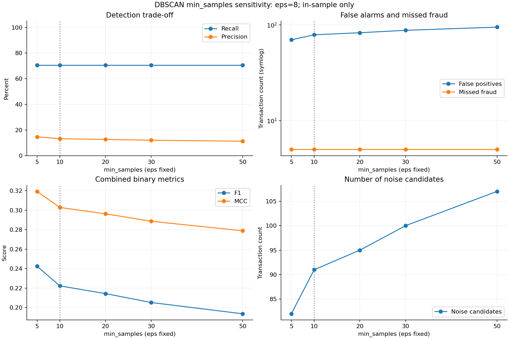

# DBSCAN 固定 eps=8 的 min_samples 实验记录

实验时间：2026-10-21T21:26:41+08:00 至 2026-10-21T21:28:23+08:00。

## 实验设计

固定 eps=8、欧氏距离、全部 30 个输入特征、原训练集缩放器和原抽样 10,000 条交易（cohort_id=`4114612fcadac989`）。仅改变 min_samples，预先设置为 5, 10, 20, 30, 50。
min_samples 包含样本自身。抽样和所有模型拟合均不使用 Class；所有拟合完成后才读取标签评价。不读取验证集、测试集。
eps=8 是上一轮同样本探索中表现较好的取值，本轮属于继续进行的样本内敏感性分析，不是独立验证或无偏的最终参数选择。

## 全部参数结果

| min_samples | 簇数 | 异常候选 | 检出欺诈 | 误报 | 漏报 | Recall | Precision | F1 | MCC | 拟合秒数 |
| ---: | ---: | ---: | ---: | ---: | ---: | ---: | ---: | ---: | ---: | ---: |
| 5 | 1 | 82 | 12/17 | 70 | 5 | 70.59% | 14.63% | 0.2424 | 0.3193 | 13.94 |
| 10 | 1 | 91 | 12/17 | 79 | 5 | 70.59% | 13.19% | 0.2222 | 0.3028 | 15.04 |
| 20 | 1 | 95 | 12/17 | 83 | 5 | 70.59% | 12.63% | 0.2143 | 0.2962 | 14.37 |
| 30 | 1 | 100 | 12/17 | 88 | 5 | 70.59% | 12.00% | 0.2051 | 0.2886 | 14.34 |
| 50 | 1 | 107 | 12/17 | 95 | 5 | 70.59% | 11.21% | 0.1935 | 0.2788 | 13.51 |

## 观察与结论

min_samples 从 5 增大到 50 时，异常候选从 82 条变为 107 条，误报从 70 条变为 95 条；检出欺诈从 12 条变为 12 条。固定 eps 时，更高的 min_samples 要求更高局部密度，因此更多交易可能被标为噪声，但噪声仍不等于欺诈。

本轮观察到的最高 F1=0.2424，对应 min_samples=5。这是同一批少量欺诈样本上的事后比较，只能作为后续独立验证的候选依据。

本轮观察到的最高 MCC=0.3193，对应 min_samples=5。这是同一批少量欺诈样本上的事后比较，只能作为后续独立验证的候选依据。

## 连续评分与评价口径

二元异常规则为 cluster_label=-1，基于该规则计算 Recall、Precision、F1、MCC 和误报数。异常候选不是已确认的欺诈。
辅助 anomaly_score 为距第 (min_samples-1) 个其他邻居的欧氏距离；min_samples 包含自身。不同 min_samples 的 k 不同，所以本轮辅助 AP、ROC-AUC 和 Recall@K 也可能改变。它们衡量不同 k 的 kNN 排序，不是 DBSCAN 的原生欺诈概率；不能把这部分变化完全归因于簇划分改善。PR-AUC 仍采用 average precision。

## 文件与复现

- results/tables/dbscan_min_samples_sweep_metrics.csv：全部参数及检测和排序指标。
- results/figures/dbscan_min_samples_sweep.png：对比图。
- results/dbscan_min_samples_sweep_labels.npz：min_samples、row_index 与逐样本 cluster_labels。
- results/dbscan_min_samples_sweep_run.json：参数、数据指纹、版本与完成状态。
- results/eps_8_min_samples_sweep/min_samples_N/：每组独立的 tables/dbscan_cluster_results.csv、figures/dbscan_clusters.png 和 dbscan_experiment_notes.md。
- 复现：`python src/dbscan_min_samples_sweep.py`。

